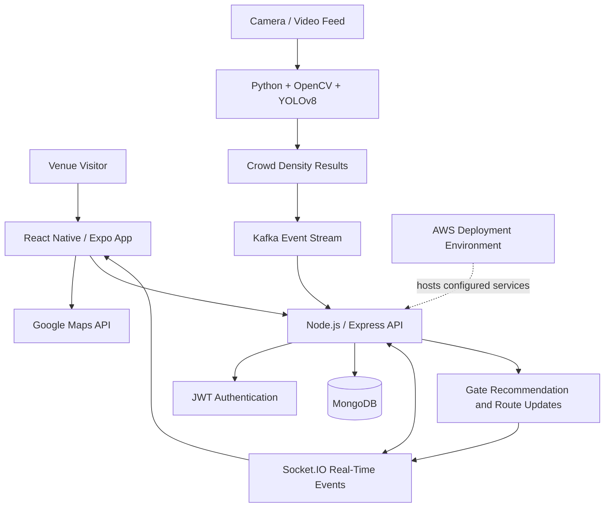
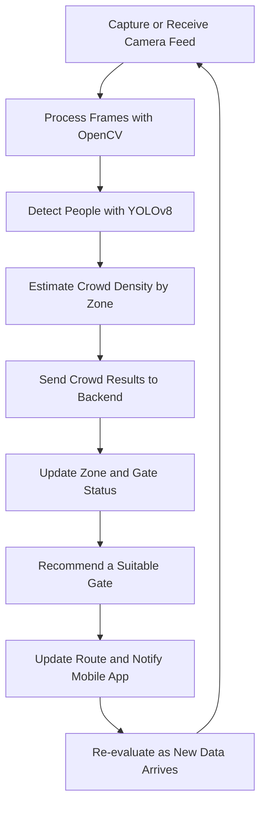

🏟️ SmartVenue --- AI-Based Crowd Navigation Application

<strong>{=html}A real-time crowd intelligence and navigation platform
that helps visitors navigate busy venues using computer vision, live
location data, and smart gate recommendations.</strong>{=html}

{=html}
{=html}
{=html}
{=html}
{=html}
{=html}

📌 Overview
SmartVenue is an AI-based crowd navigation application built to
improve movement and wayfinding inside busy venues such as stadiums,
event spaces, campuses, and large public facilities.
The mobile application uses React Native with Expo and Google Maps APIs,
while a Node.js and Express.js backend manages application APIs and
real-time communication. A Python computer-vision service uses OpenCV
and YOLOv8 to analyze camera feeds and estimate crowd density. Socket.IO
supports real-time updates, while Kafka can be used to stream crowd
events between system components.
SmartVenue aims to help users choose less crowded gates, receive updated
route suggestions, and respond to changing crowd conditions.

✨ Key Features

📍 Live Navigation & GPS Tracking
- Mobile navigation interface built with React Native and Expo.
- Google Maps integration for location and route features.
- GPS-based tracking to support location-aware navigation.
- Dynamic route recommendations based on available crowd information.
  
👁️ AI-Powered Crowd Detection
- Python-based computer-vision service.
- OpenCV for image and video processing.
- YOLOv8-based object detection to estimate crowd levels from
  supported camera feeds.
- Crowd-density results can be shared with backend services for
  navigation decisions.
  
🚪 Smart Gate Recommendations
- Evaluates crowd information for available zones or gates.
- Recommends less crowded alternatives when sufficient data is
  available.
- Supports more informed movement through busy venues.

🔄 Real-Time Updates & Dynamic Rerouting
- Socket.IO-based event communication between backend and connected
  clients.
- Updates crowd and route information as new data arrives.
- Helps the application respond to changes in crowd conditions.
  
🔔 Real-Time Alerts
- Delivers application updates when crowd or route conditions change,
  according to the configured alert workflow.
- Supports awareness of crowded zones and recommended alternatives.
  
🔐 Authentication & Backend APIs
- JWT-based authentication.
- Node.js and Express.js REST APIs.
- MongoDB for application and crowd-related data.
- Role and access restrictions can be configured according to the
  implemented authorization rules.
  
☁️ Cloud Deployment
- AWS deployment for application services, as configured in the
  project.
- Modular separation between mobile frontend, backend APIs, and AI
  processing.
  
🧰 Technology Stack
  Technology                          Purpose
  React Native                        Cross-platform mobile application
  Expo                                React Native development and build
                                      tooling
  Google Maps API                     Maps, location, and route features
  Node.js                             Backend JavaScript runtime
  Express.js                          REST API framework
  MongoDB                             Application data storage
  JWT                                 Authentication
  Socket.IO                           Real-time communication
  Python                              Crowd-analysis service
  YOLOv8                              Object detection for crowd
                                      estimation
  OpenCV                              Image and video processing
  Apache Kafka                        Event streaming between services,
                                      if enabled in deployment
  AWS                                 Cloud hosting and infrastructure
  Git & GitHub                        Version control
  
🏗️ System Architecture

Architecture note: Connect the Kafka components only if Kafka is
enabled in your deployed configuration. The diagram describes the
intended service flow; adapt it to match the exact implementation.

🔄 Crowd Navigation Workflow

📁 Example Project Structure
Your actual repository may use different names. Update this example to
reflect your folders before publishing.
smartvenue/
├── mobile/             # React Native / Expo application
├── server/             # Node.js and Express.js APIs
├── ai-service/         # Python, OpenCV, and YOLOv8 service
├── camera-producer/    # Optional camera ingestion / Kafka producer
├── README.md
└── .gitignore

🚀 Getting Started
Prerequisites
- Node.js and npm
- Expo tooling for React Native
- MongoDB local instance or hosted database
- Python 3 and pip
- Google Maps API key with the required APIs enabled
- AWS account and credentials only if deploying to AWS
- Kafka broker only if Kafka streaming is used
- YOLOv8 model weights and a supported camera/video source for AI
  inference
  
1. Clone the repository
Replace the placeholder URL with your actual GitHub repository URL.
git clone YOUR_GITHUB_REPOSITORY_URL
cd smartvenue

3. Set up the backend
Navigate to the backend directory:
cd server
npm install
Create a .env file using the exact variable names expected by your
backend. Example configuration:
PORT=5000
MONGODB_URI=your_mongodb_connection_string
JWT_SECRET=replace_with_a_secure_secret
Configure any additional variables used by your project, such as the AI
service URL, Socket.IO settings, or Kafka broker address. Never commit
real secrets.
Start the server using the script defined in package.json. For
example, if a dev script exists:
npm run dev

5. Set up the mobile app
Open a separate terminal and navigate to your React Native app
directory:
cd mobile
npm install
Configure the Google Maps API key and backend base URL using the
environment configuration supported by your app. For example:
EXPO_PUBLIC_API_URL=http://YOUR_LOCAL_NETWORK_IP:5000
EXPO_PUBLIC_GOOGLE_MAPS_API_KEY=your_google_maps_api_key
Use the variable names expected by your code. When testing on a physical
phone, use your computer's reachable local network IP rather than
localhost.
Start Expo:
npx expo start

7. Set up the AI crowd-detection service
Create a Python virtual environment:
python -m venv venv
Activate it on Windows PowerShell:
.\venv\Scripts\Activate.ps1
On macOS/Linux:
source venv/bin/activate
Install the dependencies used by your implementation. Typical packages
may include:
pip install ultralytics opencv-python
Install any additional dependencies required by your service, such as
Flask, FastAPI, Kafka clients, or numerical libraries, according to your
actual code.
Run the AI service using its configured entry point. For example:
python app.py
The exact command depends on the AI service file and framework.

⚙️ Configuration & Security
- Keep JWT secrets, database credentials, cloud credentials, and API
  keys out of source control.
- Restrict Google Maps API keys to the APIs and application platforms
  that need them.
- Validate JWTs and authorize protected backend routes.
- Secure camera feeds and ensure you have appropriate permission to
  process them.
- Avoid exposing raw camera streams or personal data unnecessarily.
- Configure CORS, network access, and service URLs for your deployment
  environment.
- If Kafka is enabled, secure broker access and configure topics and
  consumer groups appropriately.
- Use .env.example with placeholder values rather than committing
  .env.
🧪 Suggested Testing Checklist

- [ ] User authentication and protected API routes.
- [ ] Mobile app can connect to the backend.
- [ ] Google Maps loads and location permissions work.
- [ ] Camera/video input reaches the AI service.
- [ ] YOLOv8 detections produce expected crowd estimates.
- [ ] Zone or gate crowd data is stored or streamed correctly.
- [ ] Socket.IO events reach connected clients.
- [ ] Gate recommendations respond to updated crowd data.
- [ ] Route changes and alerts are handled gracefully.
- [ ] App handles unavailable location, network, or AI services.

🔮 Future Enhancements
- Historical crowd analytics and occupancy trends.
- Predictive crowd-density forecasting.
- Offline-friendly venue maps and route guidance.
- Accessibility-aware routing.
- Enhanced monitoring and health checks for deployed services.
- Automated model evaluation and end-to-end tests.
  
👨‍💻 Author
Mohit Kumar
GitHub: @Mohitkr09

📄 License
Add a LICENSE file if you want to specify how others may use, modify,
and distribute this project.
